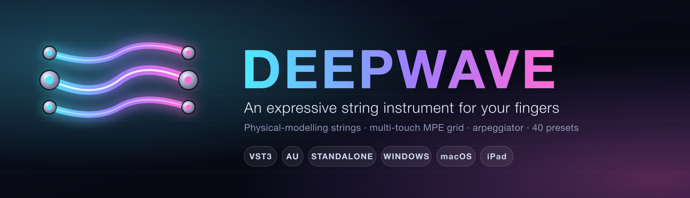
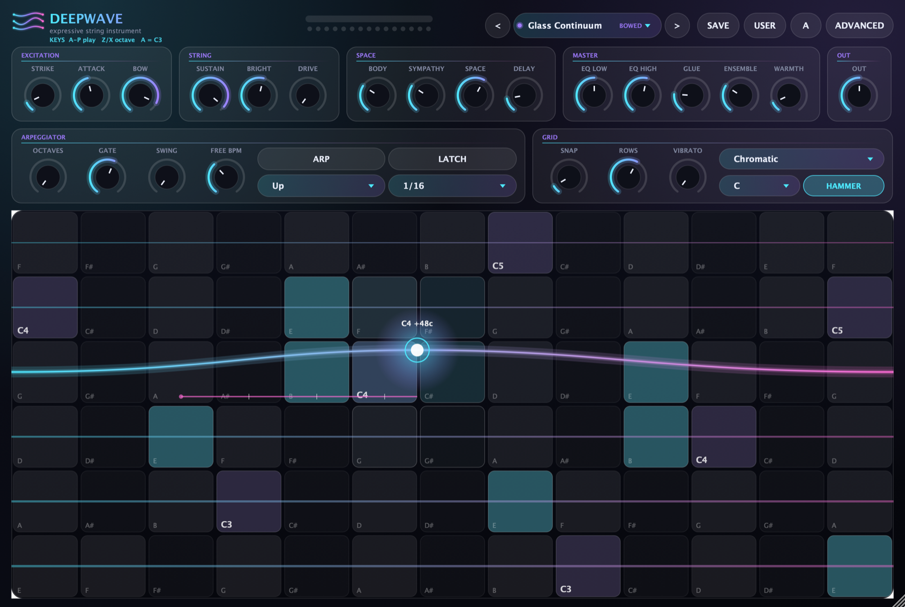
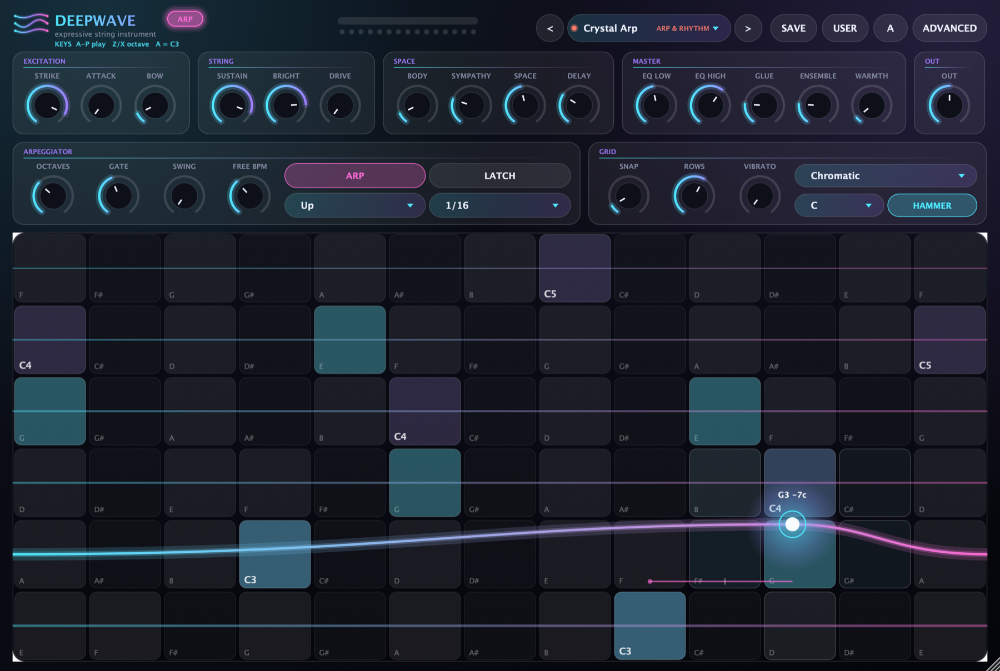
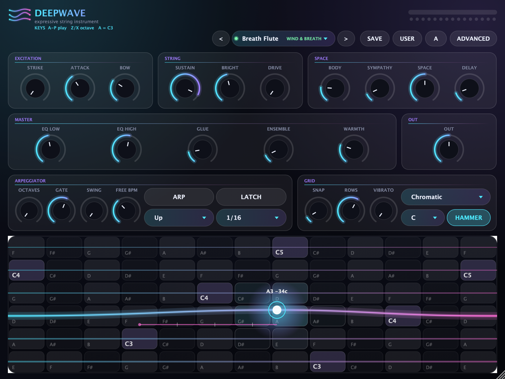

<p align="center">
  
</p>

<p align="center">
  
  
  
  
  
</p>

<p align="center">
  <b>DeepWave</b> is a physical-modelling string instrument you play with your fingers.<br>
  A multi-touch grid sends <b>MPE</b> (per-finger pitch, pressure and timbre) into a <b>digital-waveguide string synth</b>:
  slide, bend, hold, bow and arpeggiate, all continuously.
</p>

<p align="center">
  
</p>

---

## Download

**Windows (64-bit): one-click installer** → [**Releases → `DeepWave-Setup-0.1.0-x64.exe`**](../../releases/latest)

1. Run the installer and keep both boxes ticked: the **VST3 plugin** and the **standalone app**.
2. **FL Studio** (20.8+): *Options → Manage plugins → Find installed plugins*, then add **DeepWave** from the instruments.
   Ableton Live, Reaper, Cubase, Bitwig and Studio One load it as a VST3 instrument too.
3. The standalone app is in the Start menu; Settings → Apps has an uninstaller.

> The installer is not code-signed yet, so Windows SmartScreen may say *"Windows protected your PC"*:
> click **More info → Run anyway**. A portable `.zip` is on the same page.
> VST2 is not offered: Steinberg withdrew the VST2 SDK, and VST3 is what modern hosts use.

**macOS** (AU, VST3, Standalone) and **iPad** (AUv3, Standalone): build from source for now, see [Build](#build).

## What makes it fun to play

| | |
|---|---|
| **Multi-touch MPE grid** | 6 strings × 13 frets, tuned in fourths. Every finger is its own note with its own bend, pressure and timbre. Slides are continuous, with an optional fret-snap. |
| **Hold, bow, breathe** | A resting finger can keep the string singing (E-bow / stick-slip bow feedback), so you can glide and sustain like a continuous-surface instrument, not just pluck. Add breath noise for wind voices. |
| **Hammer-on / pull-off** | Tap a second finger on a string that is already ringing and it re-pitches legato instead of re-plucking. Lift to pull back off. |
| **Arpeggiator that keeps your slides** | 7 patterns, 6 note rates, 1-4 octaves, gate, swing, latch, host tempo sync. Slides, glides and vibrato on the finger carry into every arp note. |
| **Scales & auto-vibrato** | 12 scales and any root: in-scale cells light up and slides are gently pulled toward scale notes. A resting finger fades in vibrato. |
| **Play it from your keyboard** | `A W S E D F T G Y H U J K O L P` is a piano, `Z` / `X` change octave. |

<p align="center">
  
</p>

## The sound

- **Digital-waveguide strings.** A single-delay-loop model (Jaffe-Smith lineage) with continuous fractional-delay pitch, a loop loss filter,
  string-stiffness dispersion, and a pick-position comb. Every voice is a main string plus a slightly detuned twin for width.
- **Real decay times.** SUSTAIN sets how long a note rings *in seconds*, independent of pitch.
- **Body and sympathy.** A modal body resonator and sympathetic string resonators give the strings something to sing through.
- **Master polish.** Warmth saturation, 2-band EQ, ensemble chorus, glue compressor, a plate reverb, ping-pong delay, shimmer and a
  transparent output limiter, with per-preset loudness trims measured offline so presets sit at similar levels.
- **15-voice polyphony** at roughly 3% of one CPU core on a modern machine.

### 40 presets in 8 categories

| Category | Presets |
|---|---|
| **Bowed** | Glass Continuum, Velvet Cello, Violin Aria, Glass Harmonica, E-Bow Haze, Hurdy Gurdy, Dark Fiddle |
| **Plucked** | Soft Harp, Steel Pluck, Nylon Dream, Kora Rain, Koto Moon, Mandolin Spark, Dulcimer Hammer, Wire Chime |
| **Pads & Drones** | Aurora Drone, Evolving Strings, Glacier, Choir Breath, Sub Drone |
| **Leads** | Neon Lead, Singing Lead, Vintage Saw, Glide Lead |
| **Wind & Breath** | Breath Flute, Shakuhachi, Pure Whistle |
| **Bass** | Upright Bass, Sub Pluck, Growl Bass |
| **Arp & Rhythm** | Crystal Arp, Pulse Pluck 1/8, Cascade 1/16T, Ping Pong Bells, Harp Chords, Random Sparkle |
| **Cinematic** | Shimmer Swell, Frozen Cathedral, Event Horizon, Tidal Hollow |

Every preset is just a starting point: all knobs stay editable, and you can save your own (SAVE / USER) and compare A/B.

## Plays well with others

- **External MPE controllers** (such as LinnStrument or ROLI) can play the synth directly: MPE lower zone, 15 member channels, ±48 semitone per-note bend.
- **Notes from a DAW** on a single MIDI channel are accepted (not yet tested in FL Studio or GarageBand; per-note bend and pressure need the grid or an MPE controller).
- The grid also emits MPE on **MIDI out**, so it can drive other MPE synths in the same host.
- **iPad as a touch controller:** open a web page on the iPad and play DeepWave on your Mac with real multi-touch, no install needed.
  See [`tools/ipad_bridge`](tools/ipad_bridge/README.md).

<p align="center">
  
</p>

## Build

```bash
# macOS (AU, AUv3, VST3, Standalone)
cmake -B build -G Xcode
cmake --build build --config Release --target WaveGrid_Standalone     # fastest iteration
cmake --build build --config Release --target WaveGrid_AU
auval -v aumu Wgrd Dpau                                                  # validate the Audio Unit

# Windows (Visual Studio 2022 or newer)
windows\build_windows.bat          # or let CI do it: .github/workflows/windows.yml

# iPad (needs an Apple signing team; open the generated project and set it)
cmake -B build-ios -G Xcode -DCMAKE_SYSTEM_NAME=iOS -DCMAKE_OSX_DEPLOYMENT_TARGET=15.0
```

Requires CMake 3.22+ and a C++20 compiler. [JUCE 8.0.4](https://juce.com) is fetched automatically.

## Quality checks

- **Unit tests**: pitch accuracy across MIDI 28-100 (within about a cent), stability at maximum sustain and bow, master-chain and reverb behaviour,
  arpeggiator timing and MPE ordering, preset ranges. Run with `-DWAVEGRID_BUILD_TESTS=ON`.
- **CI on Windows** builds the plugin and standalone, runs the tests, builds the installer, installs it silently, validates the VST3 with
  [pluginval](https://github.com/Tracktion/pluginval) at strictness 5, then uninstalls and checks it is clean.
- **`auval`** validates the macOS/iOS Audio Unit.

## Project layout

```
Source/dsp        waveguide string, voice, body resonator, sympathetic strings
Source/fx         arpeggiator, master chain, plate reverb, delay, shimmer, limiter
Source/ui         playing grid, look-and-feel, logo, scales
Source/Presets.h  the 40 presets
tools/ipad_bridge use an iPad as a multi-touch controller
windows/          installer script and Windows build
```

More detail on the architecture and the physics notes is in [`CLAUDE.md`](CLAUDE.md); the release steps are in
[`docs/RELEASE_CHECKLIST.md`](docs/RELEASE_CHECKLIST.md).

## Status

Early release (0.1.0). The signal path and platform builds are tested automatically, but the **sound design and loudness balance were tuned by
measurement and are still being refined by ear**. Please report what sounds off. Not yet done: code signing for Windows and macOS, a macOS
installer, and a full on-device iPad build (the iPad touch bridge works today). An Android build is scaffolded under `android/` but has not been compiled.

## Licence

The source code is released under the **[MIT licence](LICENSE)**. DeepWave is built with [JUCE](https://juce.com), so **the compiled
downloads are also subject to JUCE's licence (AGPLv3 unless you hold a commercial JUCE licence)**: see
[`THIRD_PARTY_NOTICES.md`](THIRD_PARTY_NOTICES.md). *VST is a registered trademark of Steinberg Media Technologies GmbH.*

## Credits

Built with [JUCE](https://juce.com). Inspired by the published literature and open implementations: J. O. Smith's
*Physical Audio Signal Processing*, the Synthesis ToolKit, Faust `physmodels.lib`, and the MIDI MPE specification.
This is an original implementation, not a port of any proprietary instrument.
